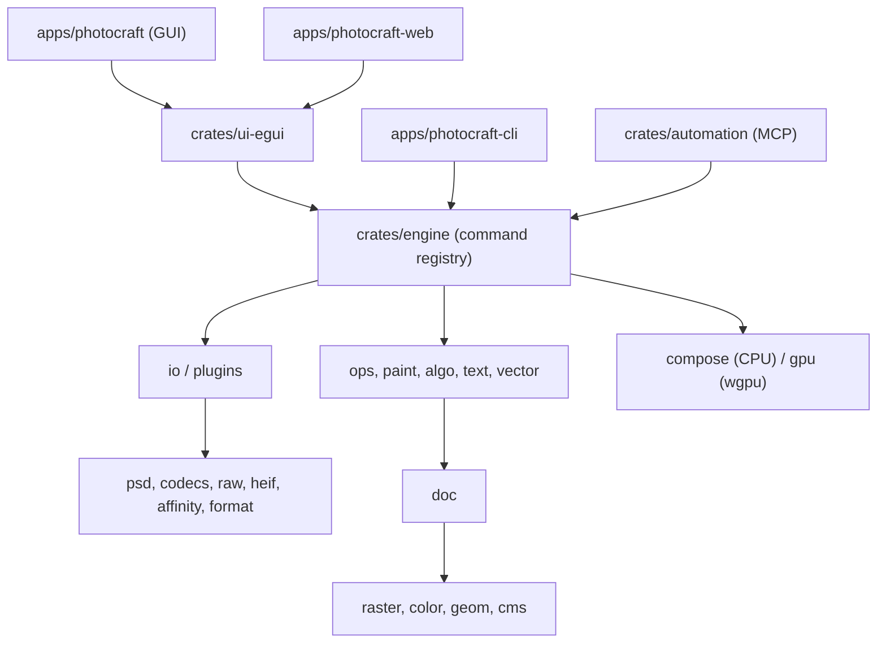

# Code map: photocraft (fork)

- Repo: iannitram/photocraft, a fork of storytold/photocraft (Rust, edition 2024, MIT OR Apache-2.0).
- Kind: native layered image editor (Photoshop-style, clean-room) as a Cargo workspace, version 0.16.0, early alpha. Desktop, CLI, MCP server and browser builds from one engine.
- Integration branch: `ours`. `main` is a copy of upstream and is not our work branch. Described commit: `729bb0166` (2026-10-26).
- Upstream: `storytold/photocraft` (`upstream/main`). Nothing is pushed or posted there. Existing `docs/maps/` holds goal maps, not a code map, so this file is `docs/code-map.md`.
- Longer references: `AGENTS.md` (workspace map and rules), `docs/architecture.md`, `docs/development.md`.

## Layout

Workspace members: `crates/*`, `apps/*`, `xtask`. Layers are enforced by `cargo xtask layers` (`xtask/src/layers.rs`); a crate may depend only on lower layers.

| Path | What it owns |
|---|---|
| `crates/geom`, `cms`, `color`, `raster` | L0 foundation: geometry; pure-Rust ICC v2/v4 colour management; pixel formats and blend math; sparse copy-on-write tiled surfaces. |
| `crates/psd`, `codecs` | L0 standalone format crates: lossless PSD/PSB reader-writer; flat raster codecs. No workspace deps. |
| `crates/raw`, `heif`, `affinity` | Camera raw decode and develop (DNG, CR2 and others); optional HEIF/HEIC decoder; Affinity document reader. |
| `crates/tablet` | Pen pressure/tilt input (AppKit, X11 XInput2, Windows barrel button). The one crate allowed `unsafe`. |
| `crates/doc` | L1 document model: layers, masks, adjustments, effects, smart objects. Pure data. |
| `crates/ops`, `paint`, `algo`, `text`, `vector` | L2: undo history; brush engine; tile-aware CPU filters and selection (`algo/src/segment`); font and text layout (parley); paths and shapes. |
| `crates/compose`, `gpu`, `format` | L3: CPU reference compositor (the oracle); wgpu compositor; native `.pcraft` bundle (zstd tiles). |
| `crates/io`, `plugins` | L4: document to PSD and flat-format mapping; sandboxed WebAssembly filter plug-ins (wasmi). |
| `crates/engine` | L5: sessions, history and the command registry (about 700 commands; every action is a command id). |
| `crates/ui-egui` | L6: egui/eframe shell, menus, dialogs, tools, `i18n/` translations. Thin; all actions go through the engine. |
| `crates/automation` | MCP server (rmcp) over the engine, plus a bridge to a running GUI. |
| `crates/ipp` | Small IPP client for CUPS printing. |
| `crates/testkit` | Test helpers. |
| `crates/craft-log`, `craft-stage` | Self-logging and named long-operation stages. Ours, not upstream. |
| `crates/wayland-drop` | Files dropped on a winit window under Wayland. Ours. |
| `apps/photocraft` | Desktop app (eframe/wgpu) with a TCP control server. |
| `apps/photocraft-cli` | Headless CLI: convert, info, run, batch, commands, mcp. |
| `apps/photocraft-web`, `photocraft-web-boot` | Browser build (trunk, wasm-bindgen, WebGPU with WebGL2 fallback) and its compressed-parts bootstrap. |
| `xtask/` | `cargo xtask` commands: ci, test, layers, wasm, stats, corpus, parity, perf, scorecard, i18n coverage. |
| `examples/plugins/invert-rs` | Example wasm filter plug-in. |
| `perf/`, `scripts/` | Performance budgets and baseline; corpus fetch and fixture scripts. |
| `packaging/` | Linux, macOS (dmg, notarization scripts), Windows, FreeBSD and web packaging. |
| `docs/`, `book/` | Architecture, parity, per-feature notes, performance reports, generated `scorecard.md`; `docs/maps/` goal maps. |
| `assets/`, `contributors/`, `scorecard/` | Icons and brand; contributor data; scorecard inputs. |

## How it fits together



- Everything is a command: menu, palette, shortcuts, CLI, JSON control channel and MCP all dispatch by command id into `crates/engine` (`CommandSpec` in `commands.rs`).
- The UI is data-driven; state lives in `ui-egui/src/state.rs` so the control channel can read and drive it. The core compiles to wasm32, so the browser build shares the engine.
- Each algorithm has a CPU reference; some also have a WGSL version reading the same `bytemuck` parameter struct, checked against the CPU result.
- Entry points: `apps/photocraft/src/main.rs`, `apps/photocraft-cli/src/main.rs`, `apps/photocraft-web/src`, `xtask/src/main.rs`.

## Where our work is

`git log upstream/main..HEAD`: about 116 commits (some are sync merges); `git diff upstream/main...HEAD` is 118 files, +8,799 / -99. Upstream was 279 commits ahead of our merge base at this snapshot. Areas:

| Area | Files touched |
|---|---|
| Self-logging: new `crates/craft-log` and `craft-stage`; wiring in `apps/photocraft/src/self_logging.rs`, `apps/photocraft-cli/src/selflog.rs`, `crates/ui-egui/src/self_logging.rs`; tests in `apps/*/tests/selflog*.rs` |
| Linux/Wayland: `crates/wayland-drop`, `apps/photocraft/src/wayland_drop.rs`, `wayland_outputs.rs` (gamescope guard, sideways panels, maximize a tall window) |
| `crates/ui-egui`: missing-font prompt (`missing_font_prompt*.rs`), snap/smart-guide behavior, Camera Raw window sizing, zh-hans, Serbian and Hungarian strings in `i18n/` |
| `crates/algo/src/segment/`: GrabCut / Boykov-Kolmogorov cancel and step-budget fixes (`budget_tests.rs`) |
| `crates/engine`, `compose`, `io`: Replace Contents size note, layer-style `edit`, stroke effect opacity, PSD/PSB save refusing a lossy timeline save, PSD export tests |
| `docs/maps/` goal and code maps, `docs/agents/`, regenerated `docs/scorecard.md` |

Several commits are sync-merge follow-ups (adapting our tests and zh-hans rows to upstream changes). Ours-only crates are marked "never offered upstream" in their headers.

## Build and test

Commands as `docs/development.md` states them (Rust stable 1.95+, `rustup target add wasm32-unknown-unknown` for web):

```sh
cargo run --release -p photocraft -- path/to/image.psd   # desktop app
cargo test --workspace
cargo xtask test      # nextest when installed, plus doctests
cargo xtask ci        # fmt, clippy, layers, scorecard, tests, panic_hunt, doctests, wasm, i18n report
cargo xtask layers    # dependency layering check
```

CI (`.github/workflows/ci.yml`): `platforms` selects legs; `gate` (shared workflow, Ubuntu, runs `cargo xtask ci --locked --features heif`); `windows` (windows-latest, unit and integration legs, only when platform-sensitive code changes); `test-without-heif`; `corpus` (real-file oracles); `web` (wasm build); `fuzz`. Other workflows: `freebsd`, `nix`, `windows-arm64`, `packaging-lint`, `docs`, `perf-nightly`, `release`, `sonarcloud`.

## Mac / PC / Linux

- All three desktops are targets, plus FreeBSD and the browser. Linux build needs libxkbcommon, wayland, x11, xrandr, xi, GL and GTK3 dev packages.
- Platform-specific code: `crates/tablet` (AppKit, X11, Windows), `crates/wayland-drop` and `apps/photocraft/src/wayland_*.rs` (Linux only), `crates/ipp` (CUPS printing), `packaging/{macos,windows,linux,freebsd,web}`.
- CI coverage (R04): Linux on every change, Windows on platform-sensitive changes, FreeBSD, Windows on ARM64 and Nix workflows exist, wasm32 checked. No macOS job appears in `ci.yml`; `release.yml` calls a shared workflow, and macOS packaging scripts live in `packaging/macos`; whether a release job builds macOS was not confirmed from this repo. A change that touches macOS-only code (tablet, packaging) is not covered by CI here.

## Open-source pieces

egui/eframe 0.37 on wgpu (UI), winit, rfd (dialogs), parley (text shaping), rayon (parallel CPU filters), image and zune-jpeg (codec support), ruzstd and flate2 (tiles and compression), wasmi (plug-in sandbox), rmcp (MCP server), clap (CLI), chrono (all date handling), proptest, criterion, egui_kittest (UI tests), trunk and wasm-bindgen (web). Suite libraries `craft-ui`, `craft-print`, `craft-docpath`, `craft-jpeg`, `craft-update` come from `storytold/craft-libs` at a pinned revision. Optional `craft-fonts` input is used by `crates/text/build.rs`.
